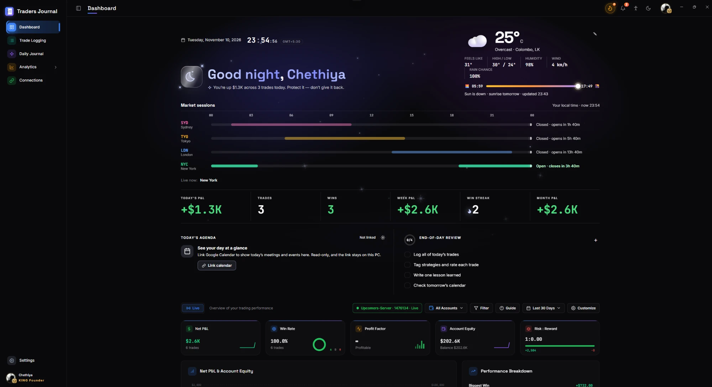
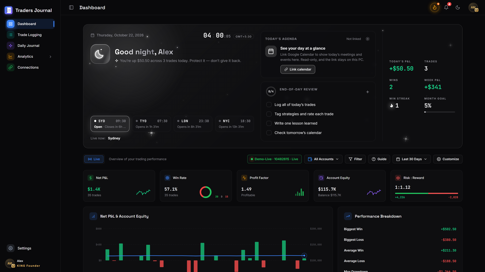
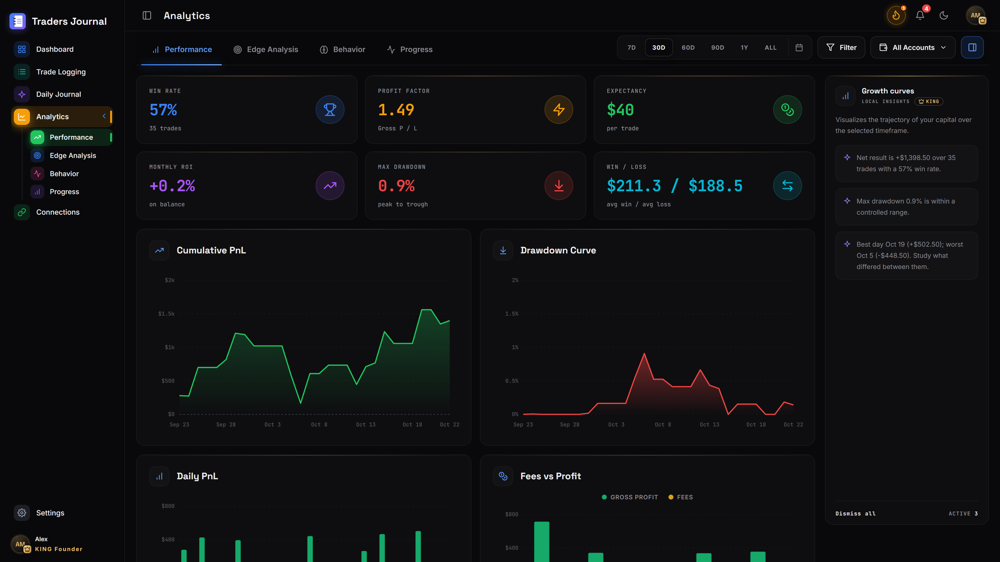
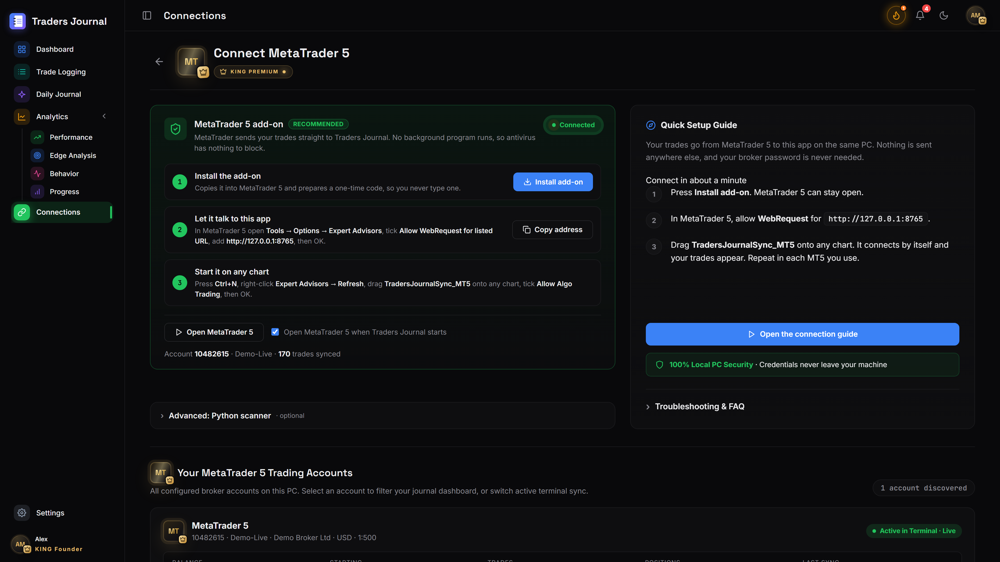
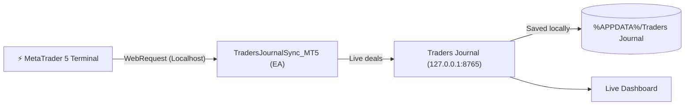

<div align="center">

  <a href="https://damsarachethiyaa-dev.github.io/github-portfolio/traders-journal/">
    
  </a>

  # Traders Journal

  ### Desktop App — Windows 10 & 11

  **Your trades. Your edge. Your own private workstation.**  
  *Real-time MetaTrader 5 deal sync (<100ms) • 100% offline localhost • Zero subscriptions • Zero cloud leaks.*

  <br />

  <p>
    <a href="https://github.com/damsarachethiyaa-dev/Traders-Journal/releases/latest"></a>
    &nbsp;
    <a href="https://damsarachethiyaa-dev.github.io/github-portfolio/traders-journal/"></a>
  </p>

  <p>
    <a href="https://github.com/damsarachethiyaa-dev/Traders-Journal/releases/latest"></a>
    &nbsp;
    
    &nbsp;
    
    &nbsp;
    
  </p>

  <p>
    <a href="https://github.com/damsarachethiyaa-dev/Traders-Journal/releases"></a>
  </p>

  <br />

  <a href="https://damsarachethiyaa-dev.github.io/github-portfolio/traders-journal/">
    
  </a>

</div>

<br />

---

## 🎯 Overview & Philosophy

Commercial cloud trading journals charge expensive recurring monthly fees, require cloud logins, and transmit your private trading strategies, broker accounts, and ticket numbers to external third-party servers.

**Traders Journal** is designed with a strict **local-first, privacy-by-default** standard:

- 🔒 **100% Local & Private:** Everything runs exclusively on your machine. Your trade tickets, reflection notes, and balance metrics stay in your local folder (`%APPDATA%\Traders Journal`). Zero data leaves your computer.
- ⚡ **Direct MetaTrader 5 Sync:** A small MetaTrader 5 Expert Advisor streams real-time deal events, partial closes, and balance updates to the app over your own computer (`http://127.0.0.1:8765`) with &lt;100ms latency.
- 🕒 **System Tray Persistence:** Minimizes silently to the Windows system tray to keep listening for closed trades even while the main window is closed.
- 🔄 **Automatic Updates:** The installed app checks for new versions, downloads them in the background, and installs on "Restart and update".

---

## 📸 Visual Tour & Features

<table>
<tr>
<td width="50%" align="center">

<br><b>📊 Live Performance & Calendar Heatmap</b><br>
<sub>Real-time equity curves, win rate %, profit factor, and daily PnL calendar grid.</sub>
</td>
<td width="50%" align="center">

<br><b>📈 4-Tab Advanced Analytics Workstation</b><br>
<sub>Deep-dive metrics across Performance, Strategy Edge, Behavior, and Progress.</sub>
</td>
</tr>
<tr>
<td width="50%" align="center">

<br><b>🔌 Real-Time MetaTrader 5 Bridge</b><br>
<sub>1-click token pairing with automatic terminal detection and live sync.</sub>
</td>
<td width="50%" align="center">

<br><b>🔐 Multi-Account Sign-In & Privacy Gate</b><br>
<sub>Animated sign-in with separate, password-protected profiles for each person.</sub>
</td>
</tr>
</table>

---

## ✨ Key Feature Matrix

| Feature | Highlight | Capability |
| :--- | :--- | :--- |
| 📊 **Live Performance Dashboard** | Real-Time Metrics | Net profit, profit factor, win rate %, expected payoff, max drawdown, and hourly performance clocks. |
| 📅 **PnL Calendar & Heatmap** | Consistency Tracking | Color-coded calendar showing green profit days, red loss days, and volume density heatmaps. |
| 📝 **Daily Journaling** | Execution Discipline | Record emotions, mistake tags, strategy setups, pre-market prep, and trade post-mortems. |
| ⚡ **Instant MT5 EA Sync** | Zero CSV Exports | Real-time deal import from MetaTrader 5 without sharing broker credentials or passwords. |
| 👑 **KING Edition Profile** | Personal Workstation | Custom alias, avatar image, account starting balance, profit targets, and dynamic theme engine. |
| 🔒 **Privacy Masking** | Safe Sharing | 1-click eye toggle blurs all sensitive monetary figures for private streaming and social sharing. |
| 🖥️ **Windows Native Shell** | Windows 10 & 11 | Custom dark titlebar, system tray minimize, and automatic startup on Windows boot. |

---

## 🚀 Quick Start & Installation

Download ready-to-run Windows files from the Releases page:

<table>
<tr>
<td width="50%" valign="top">

### 📥 1. Standard Windows Setup (Recommended)
* **File:** `Traders-Journal-Setup-1.1.0.exe` (~165 MB)
* **Features:**
  * Clean Windows installation wizard
  * Desktop & Start Menu shortcuts
  * Automatic updates and a clean uninstaller
* **Usage:** Double-click the installer and follow the prompts.

<br>

<p align="center">
  <a href="https://github.com/damsarachethiyaa-dev/Traders-Journal/releases/latest">
    
  </a>
</p>

</td>
<td width="50%" valign="top">

### ⚡ 2. Portable Standalone Executable
* **File:** `Traders-Journal-Portable-1.1.0.exe` (~155 MB)
* **Features:**
  * Runs instantly with zero installation
  * No admin rights or registry changes
  * Run it straight from a USB drive or secure folder
* **Usage:** Download and run directly.

<br>

<p align="center">
  <a href="https://github.com/damsarachethiyaa-dev/Traders-Journal/releases/latest">
    
  </a>
</p>

</td>
</tr>
</table>

> [!TIP]
> **Windows Defender SmartScreen Alert:**  
> Because this is a self-distributed release without an expensive corporate certificate, Windows may show *"Windows protected your PC - Unknown publisher"*.  
> **How to launch:** Click **"More info"**, then click **"Run anyway"**.

---

## 🔌 Connecting MetaTrader 5 (Step-by-Step)

The MT5 connector talks to the app over your own computer only (`http://127.0.0.1:8765`).



1. **Open Traders Journal:**
   - Launch the app and click **Connections** in the sidebar.
   - Click **Generate Connection Code** to get your private pairing token.
   - Click **Download Connector** to save the ready-made Expert Advisor.

2. **Install the Connector in MT5:**
   - In **MetaTrader 5**, open **File → Open Data Folder**.
   - Go to `MQL5` ➔ `Experts`.
   - Copy the downloaded `TradersJournalSync_MT5` file into `MQL5/Experts`.
   - In MT5, open the **Navigator** (`Ctrl + N`), right-click **Expert Advisors**, and click **Refresh**.

3. **Allow WebRequest in MetaTrader 5:**
   - Open **Tools → Options** (`Ctrl + O`) → **Expert Advisors** tab.
   - Check **"Allow WebRequest for listed URL"**.
   - Click the green `+` and add:
     ```text
     http://127.0.0.1:8765
     ```
   - Click **OK**.

4. **Attach to a Chart and Sync:**
   - Drag `TradersJournalSync_MT5` onto **any chart**.
   - Enter your pairing token in the Inputs tab if asked.
   - Click **OK**. Your trade history and live positions appear on your dashboard right away.

---

## 🔐 People, Sign-In & Multi-Account Security

Traders Journal is a multi-user workstation that still runs 100% on your machine:

- **Owner Account:** The first time you launch the app, you create the owner profile. No default passwords exist.
- **Strict Session Gate:** The app's local server only answers signed-in sessions, so other programs and browser tabs can't read your data.
- **Complete Profile Isolation:** Each person has their own profile, trade log, risk limits, screenshots, and MT5 pairing.
- **Salted `scrypt` Hashing:** Passwords are never stored in plain text. Five failed attempts in a row slow down further tries.
- **Optional Google Sign-In:** Connect your own Google account in **Settings → Connected Accounts**, with no cloud middleman.

---

## ❓ Troubleshooting & FAQ

#### 1. Windows SmartScreen says "Unknown Publisher"
Click **"More info"**, then **"Run anyway"**. Windows shows this for apps without an expensive commercial certificate.

#### 2. The app won't re-open
Traders Journal minimizes to the system tray when you close it. Right-click the **Traders Journal icon** near the clock and choose **Quit**, then open it again.

#### 3. MT5 reports `WebRequest error 4014`
The URL isn't on MetaTrader 5's allowlist yet. Go to `Tools → Options → Expert Advisors`, check *"Allow WebRequest for listed URL"*, and add `http://127.0.0.1:8765`.

#### 4. Where is my trading data stored?
On your PC only, in `%APPDATA%\Traders Journal\data`. Journal notes, screenshots, and account passwords never leave your computer.

---

<div align="center">

**Traders Journal — KING Lifetime Edition** · by [damsarachethiyaa-dev](https://github.com/damsarachethiyaa-dev)

<sub>This repository holds the app downloads only.</sub>

*Happy Trading! Manage your risk, follow your journal rules, and protect your edge.*

</div>
