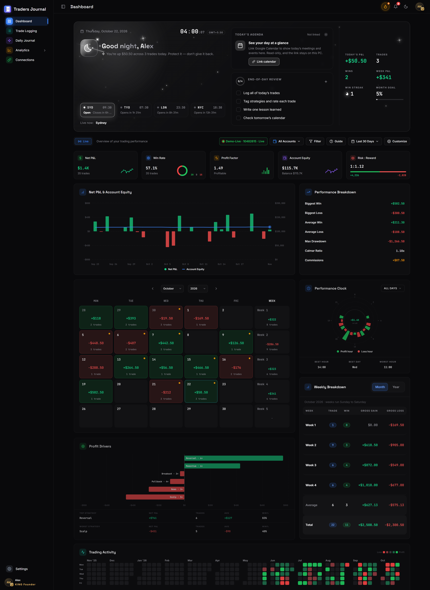
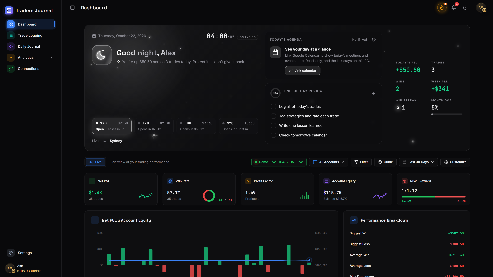
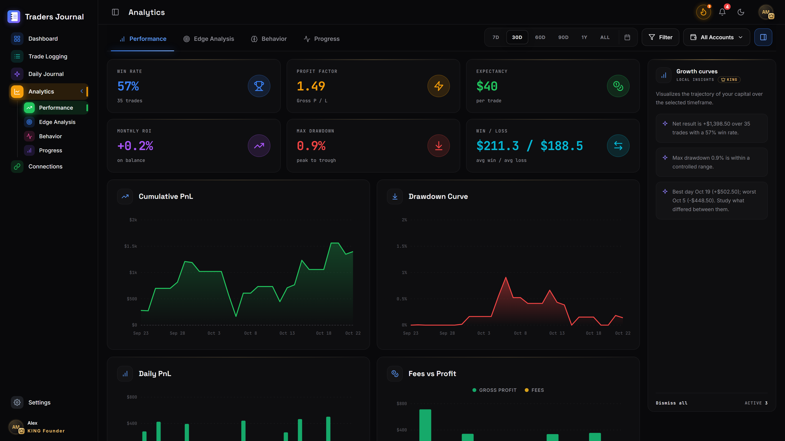
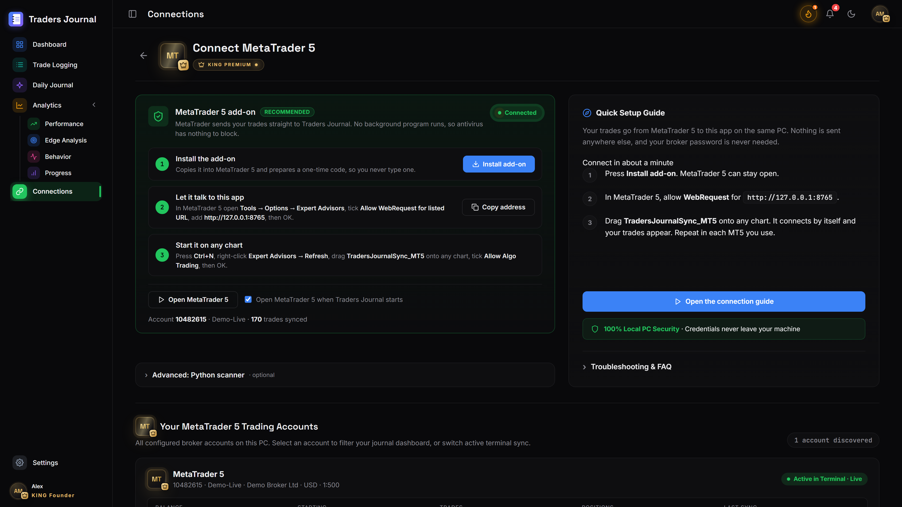
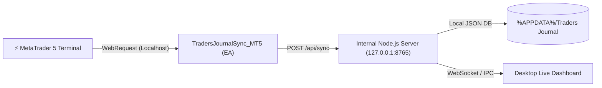

<div align="center">

<a href="https://github.com/damsarachethiyaa-dev/Traders-Journal">
  
</a>

# Traders Journal
### Desktop App — KING Lifetime Edition

**Your trades. Your edge. Your own private workstation.**  
*Real-time MetaTrader 5 deal sync (<100ms) • 100% offline localhost • Zero subscriptions • Zero cloud leaks.*

<br>

<p align="center">
  <a href="https://github.com/damsarachethiyaa-dev/Traders-Journal/releases/latest">
    
  </a>
  &nbsp;&nbsp;
  <a href="https://damsarachethiyaa-dev.github.io/github-portfolio/traders-journal/">
    
  </a>
</p>

<p align="center">
  
  
  
  
</p>

<p align="center">
  <a href="https://github.com/damsarachethiyaa-dev/Traders-Journal/releases">
    
  </a>
  &nbsp;
  <a href="https://github.com/damsarachethiyaa-dev/Traders-Journal/releases/latest">
    
  </a>
</p>

<br>

<a href="https://github.com/damsarachethiyaa-dev/Traders-Journal">
  
</a>

<br><br>

<p align="center">
  <a href="#-overview--philosophy"><b>Overview</b></a> &nbsp;•&nbsp;
  <a href="#-visual-tour--features"><b>Visual Tour</b></a> &nbsp;•&nbsp;
  <a href="#-quick-start--installation"><b>Download & Install</b></a> &nbsp;•&nbsp;
  <a href="#-connecting-metatrader-5-step-by-step"><b>MT5 Sync Guide</b></a> &nbsp;•&nbsp;
  <a href="#-people-sign-in--multi-account-security"><b>Security & People</b></a> &nbsp;•&nbsp;
  <a href="#-developer--build-guide"><b>Developer Guide</b></a> &nbsp;•&nbsp;
  <a href="#-project-architecture"><b>Architecture</b></a> &nbsp;•&nbsp;
  <a href="#-troubleshooting--faq"><b>FAQ</b></a>
</p>

</div>

<br>

---

## 🎯 Overview & Philosophy

Commercial cloud trading journals charge expensive recurring monthly fees, require cloud logins, and transmit your private trading strategies, broker accounts, and ticket numbers to external third-party servers.

**Traders Journal** is designed with a strict **local-first, privacy-by-default** standard:

- 🔒 **100% Local & Private:** Everything runs exclusively on your machine. Your trade tickets, reflection notes, and balance metrics stay in your local directory (`%APPDATA%\Traders Journal` or `./data/db.json`). Zero data leaves your computer.
- ⚡ **Direct MetaTrader 5 Sync:** Uses a custom MQL5 Expert Advisor (`TradersJournalSync_MT5`) and a dedicated loopback bridge (`http://127.0.0.1:8765`) to stream real-time deal events, partial closes, and balance updates with &lt;100ms latency.
- 🕒 **System Tray Persistence:** Minimizes silently to the Windows system tray to continuously listen for closed trades even while the main window is closed.
- 🎬 **Cinema-Grade Branded Intro:** Bundled native intro presentation and high-resolution video engine.

---

## 📸 Visual Tour & Features

<table>
<tr>
<td width="50%" align="center">

<br><b>📊 Live Performance & Calendar Heatmap</b><br>
<sub>Real-time equity curves, win rate %, profit factor, and daily PnL calendar grid.</sub>
</td>
<td width="50%" align="center">

<br><b>📈 4-Tab Advanced Analytics Workstation</b><br>
<sub>Deep-dive metrics across Performance, Strategy Edge, Behavior, and Progress.</sub>
</td>
</tr>
<tr>
<td width="50%" align="center">

<br><b>🔌 Real-Time MetaTrader 5 Bridge</b><br>
<sub>1-click token pairing with automatic terminal detection and live socket sync.</sub>
</td>
<td width="50%" align="center">

<br><b>🔐 Multi-Account Sign-In & Privacy Gate</b><br>
<sub>60 FPS interactive engine with per-person salted scrypt isolation.</sub>
</td>
</tr>
</table>

---

## ✨ Key Feature Matrix

| Feature | Highlight | Capability |
| :--- | :--- | :--- |
| 📊 **Live Performance Dashboard** | Real-Time Metrics | Net profit, profit factor, win rate %, expected payoff, max drawdown, and hourly performance clocks. |
| 📅 **PnL Calendar & Heatmap** | Consistency Tracking | Color-coded calendar showing green profit days, red loss days, and volume density heatmaps. |
| 📝 **Daily Journaling** | Execution Discipline | Record emotions, mistake tags, strategy setups, pre-market prep, and trade post-mortems. |
| ⚡ **Instant MT5 EA Sync** | Zero CSV Exports | Real-time deal ingestion from MetaTrader 5 without sharing broker credentials or passwords. |
| 👑 **KING Edition Profile** | Personal Workstation | Custom alias, avatar image, account starting balance, profit targets, and dynamic theme engine. |
| 🔒 **Privacy Masking** | Safe Sharing | 1-click eye toggle blurs all sensitive monetary figures for private streaming and social sharing. |
| 🖥️ **Windows Native Shell** | Windows 10 & 11 | Custom dark titlebar overlay, system tray minimize, and automatic startup on Windows boot. |

---

## 🚀 Quick Start & Installation

You can download ready-to-run Windows binaries directly from the official Releases page:

<table>
<tr>
<td width="50%" valign="top">

### 📥 1. Standard Windows Setup (Recommended)
* **File:** `Traders-Journal-Setup-1.0.9.exe` (~190 MB)
* **Features:**
  * Clean Windows installation wizard
  * Automatic Desktop & Start Menu shortcuts
  * Seamless automatic updates and clean uninstaller
* **Usage:** Double-click the installer and follow on-screen prompts.

<br>

<p align="center">
  <a href="https://github.com/damsarachethiyaa-dev/Traders-Journal/releases/latest">
    
  </a>
</p>

</td>
<td width="50%" valign="top">

### ⚡ 2. Portable Standalone Executable
* **File:** `Traders-Journal-Portable-1.0.9.exe` (~180 MB)
* **Features:**
  * Runs instantly with zero installation
  * Requires no admin privileges or registry changes
  * Perfect for running directly from a USB drive or secure folder
* **Usage:** Download and run directly.

<br>

<p align="center">
  <a href="https://github.com/damsarachethiyaa-dev/Traders-Journal/releases/latest">
    
  </a>
</p>

</td>
</tr>
</table>

> [!TIP]
> **Windows Defender SmartScreen Alert:**  
> Because this is a self-distributed standalone release without an expensive corporate certificate, Windows may show *"Windows protected your PC - Unknown publisher"*.  
> **How to launch:** Click **"More info"**, then click **"Run anyway"**.

---

## 🔌 Connecting MetaTrader 5 (Step-by-Step)

The MT5 connector establishes an encrypted HTTP connection over your computer's local loopback network (`http://127.0.0.1:8765`).



### Setup Steps:

1. **Open Traders Journal:**
   - Launch the application and click on **Connections** in the sidebar.
   - Click **Generate Connection Code** to receive your unique local pairing token.
   - Click **Download Connector** to retrieve the pre-configured Expert Advisor.

2. **Install the Connector in MT5:**
   - In **MetaTrader 5**, open the top menu and click **File → Open Data Folder**.
   - Navigate to `MQL5` ➔ `Experts`.
   - Copy `TradersJournalSync_MT5.mq5` (or `TradersJournalSync_MT5.ex5`) from the `connector/` directory into `MQL5/Experts`.
   - In MT5, open the **Navigator** window (`Ctrl + N`), right-click **Expert Advisors**, and click **Refresh**.

3. **Enable WebRequest in MetaTrader 5:**
   - In MT5, open **Tools → Options** (`Ctrl + O`) and switch to the **Expert Advisors** tab.
   - Check **"Allow WebRequest for listed URL"**.
   - Click the green `+` icon and add:
     ```text
     http://127.0.0.1:8765
     ```
   - Click **OK**.

4. **Attach to Chart and Sync:**
   - Drag `TradersJournalSync_MT5` onto **any active chart**.
   - In the Inputs tab, enter your pairing token if prompted.
   - Click **OK**. Your historical trades and live positions will immediately synchronize with your dashboard!

---

## 🔐 People, Sign-In & Multi-Account Security

Traders Journal is a multi-user workstation that still runs 100% on your machine:

- **Owner Account:** The first time you launch the app, you create the master owner profile. No default credentials exist.
- **Strict Session Gate:** Every request to the internal loopback server requires an active session token. External browser tabs and rogue background processes cannot read your data.
- **Complete Profile Isolation:** Each person maintains their own separate profile, trade log, risk thresholds, screenshots, and MT5 pairing links.
- **Salted `scrypt` Encryption:** Passwords are never saved in plain text; they are hashed with cryptographic salt. Five consecutive failed attempts trigger progressive rate limiting.
- **Verified Google Sign-In:** Configure your personal Google Cloud OAuth Desktop Client in **Settings → Connected Accounts** to connect your Google identity with zero cloud middleman.

---

## 🛠️ Developer & Build Guide

### Prerequisites
- **Node.js:** v18.0.0+ ([Download Node.js](https://nodejs.org))
- **npm:** v9.0.0+
- **Python:** v3.10+ (optional, for standalone `tools/mt5_sync.py`)
- **MetaTrader 5:** For compiling MQL5 connector scripts

### Quick Development Run
```bash
# 1. Clone the repository
git clone https://github.com/damsarachethiyaa-dev/Traders-Journal.git
cd Traders-Journal

# 2. Install dependencies
npm install

# 3. Start development desktop app
npm start
```

### Packaging Windows Installers (.EXE)
```bash
# Automated 1-click build script
scripts\build_installer.bat

# Or direct terminal command
npm run dist
```

Build outputs are saved to the `dist/` directory:
- `dist/Traders-Journal-Setup-1.0.9.exe` — Full Windows NSIS installer
- `dist/Traders-Journal-Portable-1.0.9.exe` — Standalone portable executable
- `dist/win-unpacked/` — Unpacked binary folder for fast testing

---

## 📂 Project Architecture

```text
Traders-Journal/
├── .gitignore                      # Git ignore rules for node_modules, dist, temp logs
├── .gitattributes                  # Line ending normalization & binary handling
├── package.json                    # Project configuration, scripts & electron-builder settings
├── package-lock.json               # Locked npm dependency tree
├── README.md                       # Modern repository hero & documentation
│
├── src/                            # Application Source Code
│   ├── main.js                     # Electron main process (window, tray, app lifecycle)
│   ├── preload.js                  # Secure Electron preload bridge
│   ├── server.js                   # Local HTTP backend server (http://127.0.0.1:8765)
│   ├── accounts.js                 # Local accounts, scrypt auth & session isolation
│   ├── index.html                  # Primary Live Dashboard & Analytics UI
│   ├── hero.js / hero.css          # Main dashboard presentation & KPI rendering
│   ├── analytics.js / .css         # 4-tab advanced analytics workstation
│   ├── daily-journal.js / .css     # Daily trade reflections & notes management
│   ├── settings.js / .css          # Settings workstation, profiles & connected accounts
│   ├── auth.js / auth.css          # High-performance 60 FPS animated sign-in suite
│   ├── auth-boot.js                # Early authentication bootstrap gate
│   ├── app-intro.html / .js / .css # Native animated intro splash window
│   └── gcal.js                     # Economic calendar / Google calendar integration
│
├── scripts/                        # Automated Execution & Build Scripts
│   ├── start.bat                   # Instant application launcher
│   ├── run_app.bat                 # Fast development runner
│   ├── build_installer.bat         # 1-click script to build Windows .EXE installer
│   ├── update_project.bat          # 1-click script to commit and push updates
│   ├── setup-mt5.bat               # Automated MT5 Python environment setup
│   ├── sync-mt5.bat                # Direct MT5 sync script
│   └── Launch Traders Journal.vbs  # Silent Windows background launcher
│
├── build/                          # Application icon for desktop & installer
├── connector/                      # MetaTrader 5 Expert Advisor (source & binary)
├── docs/                           # Architecture specs, release guides & scan reports
├── fonts/                          # Bundled fonts (Inter, JetBrains Mono, Space Grotesk)
├── media/                          # Intro video, app film, and graphic assets
└── tools/                          # Test suites, icon builders, and Python MT5 sync
```

---

## ❓ Troubleshooting & FAQ

#### 1. Windows SmartScreen says "Unknown Publisher"
Click **"More info"**, then click **"Run anyway"**. This alert appears for any open-source application without an expensive commercial EV certificate.

#### 2. The app is already running and won't re-open or rebuild
Traders Journal minimizes to the system tray on close. Right-click the **Traders Journal icon** in your Windows taskbar clock tray and select **Quit**. Or run `scripts\build_installer.bat`, which automatically terminates background processes before rebuilding.

#### 3. MT5 reports `WebRequest error 4014`
You have not added the URL to MetaTrader 5's allowlist. In MT5, navigate to `Tools → Options → Expert Advisors`, check *"Allow WebRequest for listed URL"*, and add `http://127.0.0.1:8765`.

#### 4. Where is my trading data stored?
Synced MT5 records are stored locally at `%APPDATA%\Traders Journal\data\db.json` (in packaged mode) or `data/db.json` (in development mode). Journal reflections, screenshots, and account credentials never leave your PC.

---

## 👤 Author & Credits

- **Developer & Creator:** [Chethiya Rathnasekara](https://github.com/damsarachethiyaa-dev)
- **Application:** Traders Journal — KING Lifetime Edition
- **Version:** 1.0.9

*Happy Trading! Manage your risk, follow your journal rules, and protect your edge.*
